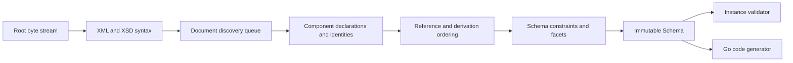

# Architecture

## Boundaries

Immutable models feed validation/generation.

## Pipeline



Identities intern before resolution; slices order walks/output.
Phases never backpatch.

## Resolution

`ParseSchema(root ResolvedSource, resolver Resolver)` uses Compatibility;
`ParseSchemaWithPolicy` selects policy. Resolvers acquire sources; streams close,
identities decode once.

```go
type Resolver interface {
    Resolve(ctx context.Context, namespaceURN, schemaLocation string) (ResolvedSource, error)
}
```

Sources retain opaque identity/context; resolvers own locations.
Discovery is sequential FIFO; resolver calls are sequential.
`Loc`: one-based lines, Unicode code-point columns.

## Diagnostics

Invalid/unsupported/resolution/internal diagnostics retain code, primary/related
`Loc`, spec reference, cause; errors prevent `Schema`. Unsupported
features have stable IDs.

## Schema model

Immutable components; ordered walks. Elements retain identity
constraints, XPath, namespace scopes, `Loc`s, and keyref targets.
IDs/duplicates precede refs; unresolved/invisible/ambiguous targets yield
`FailureResolution` at `refer`, wrong-kind/field-count `FailureInvalid`.

Bounded empty-base extensions/`xs:anyType` restrictions retain refs, IDs/`Loc`s,
and `##other`/`lax` wildcards.
Grouped/sequence extensions admit named/global-element inline owners; anonymous identity persists, excluding ID/inheritable/list/union uses.
SimpleContent retains base/type/use `Loc`s, nil particle; base/final/dependencies precede owner/use gates. Boolean/string/integer/decimal, policy-gated `precisionDecimal`.
Named attribute-free simpleContent extensions query built-in/supported named effective atomic `xs:normalizedString`/`xs:token`/`xs:NMTOKEN` bases; restrictions remain unsupported.
Direct and extension particles model selected integer-family locals; named
direct models add sign restrictions. Built-in/named integer validates;
broader derivatives and extensions remain query-only.
Syntax/policy/occurrences precede mapping; refs precede omission.
Named direct choice/sequence and named-group sequence/nested-choice locals map matching `targetNamespace`.
Compatibility/Strict11 admit; Strict10 rejects; absent/mismatched owners or form/ref conflicts invalidate. [Contract](doc.go).
Groups nest opposites; refs resolve before `0/0`. Sequences/nested choices retain atomic integer/string/token locals with copied IDs/facets/QNames/`Loc`s/bounds.
Anonymous global-element `complexContent/extension` over supported named empty-content bases (`##other`/`lax` `anyType` included) admits ref-only choice, nested sequence with default `1/1` group ref then element ref, or both choice-first; exact bounds/order/targets/`Loc`s persist with inherited wildcard.
Other owners, broader nesting, direct groups, wildcards, locals, and combined attributes stay unsupported.
Type conflicts: XSD3063; ambiguity rejects with related `Loc`s.
Valid inline-simple/untyped `0/0` omits; nonzero/broader/deeper/
wildcard/`all` reject. Cycles XSD3062; consumers reject at group `RefLoc`.
Named direct `all`: ordered supported locals/refs, exact bounds/omission/duplicate
`Loc`s; XSD 1.0 maxima ≤1, XSD 1.1 repeats/outer `0/0`; anonymous simple-type
`0/0` omits; anonymous complex members/consumers reject.
AttributeUse retains ordered IDs/`Loc`s; extensions resolve models→uses→base.
`0/0`/prohibited omit; chameleon adopts; XSD 1.1 `targetNamespace` must match.
Named empty/all/choice/sequence/group/grouped/sequence-extension owners omit `inheritable=false/0` in Compatibility/Strict11;
Strict10, true/1, refs, and other owners reject.
Named empty/choice/sequence/grouped/extension: facet-free `xs:ID`, built-in/named
`xs:NCName` and `xs:normalizedString`; named all: facet-free `xs:ID` (Strict10: one per owner).
Built-in `xs:language`/`xs:anyURI` query on named empty/choice/sequence;
built-in/named `xs:token`/`xs:NMTOKEN` on named empty.
Named empty/choice/sequence query built-in/named `xs:long` with bounds.
Inline/ref/value/other owners and consumers reject.
Global attributes: built-in/named Boolean/integer/decimal/normalizedString/token/negativeInteger/positiveInteger/nonPositiveInteger/language/
NCName/anyURI/ID/long/int/short/byte/unsignedLong, policy-gated `precisionDecimal`.
Compatibility/Strict11 omit untyped-global `inheritable=false/0`;
Strict10/true/1 reject; refs reject at use `Loc`.
Inline varieties retain IDs/refs/`Loc`s/facets/`finalDefault`; atomic inline
`normalizedString` admits. Atomic NCName preserves enumeration order, inherited
narrowing, fixed collapse. Enumerated NCName list/union members reject;
facet-free admit. Explicit whiteSpace/pattern/length, local inline NCName,
list/union attribute refs, default/fixed, and consumers reject.
Default/fixed covers built-in/named Boolean/integer/decimal/token/negativeInteger/nonPositiveInteger/positiveInteger/long/int/short/byte/unsignedLong and policy-gated `precisionDecimal`.
Integer exact; unsignedLong digits-only Strict10, plus/signed-zero
Compatibility/Strict11. Local refs to global inline lists/unions reject; atomic
refs query-only. Inline defaults/fixed fail at value `Loc`;
invalid values retain causes/related `Loc`s. Conflicts locate fixed/default;
type-only unconstrained; global attribute consumers reject.

Complexes retain abstract/final/block provenance, groups/extensions/wildcards. Empty named bodies lack particle/occurrence; they and untyped globals admit empty `block` overriding defaults. Named block `Loc` persists; untyped view/block facts absent; nonempty policies/consumers reject.
`xs:any`: positive sets, 1.1 strict/lax/skip `notNamespace`, chameleons, `0/0`. Compatibility/Strict11 direct strict `notQName` retains source-ordered normalized tokens (duplicates), bindings/`Loc`, sorted unique expanded names; conflicts before omission; other placements/consumers reject.
`openContent=none` excludes Strict10; named groups retain refs/ranges.
Inline-complex `mixed=false/0`, inline-complex/untyped-global `abstract=false/0`/`nillable=false/0` omit; true/1 reject, malformed retain cause/`Loc`. Typed or inline-simple globals expose true.
Compatibility/Strict11 omit `defaultAttributesApply`; Strict10/schema `defaultAttributes` reject.
Inline IDs omit from walks; selected precisionDecimal sequences validate.
Bounded local lists use precisionDecimal; unions pair precisionDecimal/negativeInteger.
Strict10 rejects precisionDecimal. Element refs retain ranges.
Named direct choices/sequences query built-in/named `normalizedString`; consumers reject.
Facet-free `QName` varieties/global refs retain context; QName locals/attributes/facets/values reject.

## Datatypes

Lexical/value forms differ.
QName value conversion needs namespace context and remains unsupported.
Datatypes map string enumeration, arbitrary precision, exact Compatibility/Strict11
precisionDecimal facets, Boolean whitespace; broader facets/temporal values reject.

## Validation and code generation

`ValidateInstance` handles selected scalar roots, lists/unions, and ordered
typed/ref sequences. Compatibility/Strict11 admit precisionDecimal; Strict10
rejects it before publication. Lists split XML whitespace; unions preserve
member order. Bounded variety sequences accept selected typed/anonymous locals
and refs. Outer occurrences default; child ranges are exact. Default direct-choice
refs to unconstrained Boolean/integer/decimal globals validate; constrained
targets relate `Loc`. Exact supported types are in [the contract](doc.go).
SimpleContent accepts built-in string with selected precisionDecimal attributes
or built-in/named effective precisionDecimal; named effective string excludes.
Inline roots validate selected sequences (including bounded list/union), attributes,
simpleContent; inline complex-content extensions reject even after 0/0/prohibited omission.
Mixed-content validation is unsupported; `GenerateGo` rejects inline complex roots.
Nonzero `xs:any` is query-only. Identity-constrained roots reject at instance-use `Loc`,
relating first constraint. QName globals/refs reject validation/generation with
located diagnostics. Structure precedes facets; first failure retains instance/
schema `Loc`s. Occurrence and scalar failures differ. `xsi:schemaLocation` never
resolves. Other byte/short/int/long/unsignedLong validation uses reject.

Generation covers selected named/inline scalars, default Boolean/integer/decimal
choices and sequences, and all-token choices. Other locals, attributes, and
reference targets reject; see [the contract](doc.go).
No-view globals, admitted `abstract=true`/`nillable=true` globals, identity constraints yield `GOXSD9029`, nil output.
Default integer/decimal sequence refs retain TargetID/order. Built-in bounded
integers use `StrictInteger`; `IntegerBounds()` copies effective bounds.
Byte bounds [-128,127]; unsignedLong bounds [0,18446744073709551615]. Named
facets retain provenance. Unsupported final/
variety/effective facets yield `GOXSD9029`; malformed facts `GOXSD9030`.
Nonzero inline `nonNegativeInteger` has no schema; valid `0/0` terms omit.

## Conformance

Pinned W3C artifacts classify pass/conformance/unsupported/resolution/internal
outcomes; tooling checks XSD 1.0 envelope/DTD order without changing parser behavior.
