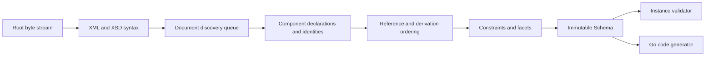

# Architecture

## Pipeline



Identities precede references; slices order walks/output; no backpatching.

## Resolution

`ParseSchema` defaults Compatibility; `ParseSchemaWithPolicy` selects policy.
Resolvers acquire sources; streams close; identities decode once.

```go
type Resolver interface {
    Resolve(ctx context.Context, namespaceURN, schemaLocation string) (ResolvedSource, error)
}
```

Sources retain opaque identity/context; resolvers own locations.
FIFO discovery; sequential calls. `Loc`: one-based lines, Unicode code-point columns.

## Diagnostics

Diagnostics retain class/code, primary/related `Loc`, spec reference, and cause;
errors prevent `Schema`.

## Schema model

Elements retain identity constraints, XPath, namespace scopes, `Loc`s, keyref targets.
IDs/duplicates precede refs; unresolved/invisible/ambiguous targets yield
`FailureResolution` at `refer`; wrong-kind/field-count yield `FailureInvalid`.

Extensions/restrictions retain IDs/`Loc`s/wildcards. Named-base restrictions need
completed particle-free, use-free bases. Derived namespace/process constraints
must narrow; ##other retains origin under edition-specific rules.
Negative/QName-constrained restriction comparisons remain unsupported.
Missing bases, widening, final, cycles invalidate; missing derived
wildcards, richer bodies, consumers are unsupported.
Grouped/sequence IDs persist; ID/list/union and nested `inheritable` excluded.
SimpleContent retains base/type/use `Loc`s, nil particle; dependencies precede owner gates. Boolean/string/integer/decimal, policy-gated `precisionDecimal`.
Attribute-free named simpleContent queries facet-free language/anyURI; restrictions/consumers reject.
Direct/extension particles model selected integers; named direct adds sign restrictions. Built-in/named integers validate; other extensions are query-only.
Syntax/policy/occurrences precede mapping; refs precede omission.
Named direct choice/sequence and named-group sequence/nested-choice locals match `targetNamespace`.
Compatibility/Strict11 admit; Strict10, absent/mismatched owners, form/ref conflicts invalidate.
Named-group choices reject direct element-ref substitution overlaps beside group refs; group-ref attribution unchecked. Atomic-local/opaque-ref facts: [contract](doc.go).
Empty-base anonymous extensions admit ref-only choice, nested group/element-ref sequence, or both; bounds/order/targets/`Loc`s/wildcard persist.
Broader nesting/direct groups/wildcards/locals/nested attributes reject.
Type conflicts: XSD3063; ambiguity relates `Loc`s.
Valid inline-simple/untyped `0/0` omits; broader nesting/wildcard/`all` reject. Cycles XSD3062; consumers reject at group `RefLoc`.
Named direct `all`: ordered locals/refs, bounds/`Loc`s; 1.0 maxima≤1,
1.1 repeats/outer `0/0`; anonymous members/consumers reject.
Models→ordered uses→base; `0/0`/prohibited omit; chameleons adopt; 1.1 `targetNamespace` matches.
Compatibility/Strict11 omit false/0 local `inheritable` after owner checks; Strict10/true/1/refs reject.
Direct-sequence: empty bases. Named grouped extensions: use-free
optional-ref-sequence base, zero own uses; completed sequence-extension base,
one optional direct local ID. Both: default 1/1 sequence, 0/1 global ref.
Collisions; Strict10 second effective IDs fail.
Named effective `xs:short`/`xs:int`/`xs:byte`/`xs:unsignedLong` grouped uses: empty/use-free bases.
Named empty/choice/sequence/all/direct-group/grouped/sequence extensions retain facet-free `xs:ID`; these retain built-in/named atomic `xs:NCName`/`xs:normalizedString`.
Named empty/direct-choice/direct-sequence/direct-all/direct-group owners: built-in/facet-free named `xs:language`/`xs:anyURI`; named direct-sequence/grouped extensions likewise. Consumers reject.
Named owners: token/NMTOKEN built-in/named empty/choice/sequence/direct-sequence/grouped/direct-group; V/G reject.
Anonymous empty-base ref-sequences: built-in `xs:token`/`xs:anyURI`; consumers reject.
`xs:long`: named empty/choice/sequence/all/direct-group/direct-sequence/grouped owners, built-in/named uses.
Named empty/choice/sequence/all and empty-base direct-sequence/grouped extensions:
built-in/named `xs:short`/`xs:int`/`xs:byte`/`xs:unsignedLong`. Consumers reject.
Global attributes: built-in/named Boolean/integer/decimal/normalizedString/token/negativeInteger/positiveInteger/nonPositiveInteger/language/
NCName/anyURI/ID/long/int/short/byte/unsignedLong, policy-gated `precisionDecimal`.
Compatibility/Strict11 omit untyped-global `inheritable=false/0`;
Strict10/true/1 reject; refs reject at use `Loc`.
Inline varieties retain IDs/refs/`Loc`s/facets/`finalDefault`; atomic inline
`normalizedString` admits. Atomic NCName preserves enumeration order, inherited
narrowing, fixed collapse. Enumerated NCName list/union members reject;
facet-free admit. Explicit whiteSpace/pattern/length, local inline NCName,
list/union attribute refs, default/fixed, and consumers reject.
Default/fixed covers built-in/named Boolean/integer/decimal/token/negativeInteger/nonPositiveInteger/positiveInteger/long/int/short/byte/unsignedLong and policy-gated `precisionDecimal`.
Integer exact; unsignedLong digits-only Strict10, plus/signed-zero
Compatibility/Strict11. Local refs to global inline lists/unions reject; atomic
refs query-only. Inline defaults/fixed fail at value `Loc`, retaining
causes/related `Loc`s. Conflicts locate fixed/default; type-only unconstrained;
global attribute consumers reject.

Named/untyped-global empties admit empty `block`; named lack particles/occurrences.
Block `Loc` persists; untyped omit; nonempty policies/consumers reject.
Named direct choice/sequence `xs:any`: empty/positive all policies; Compatibility/Strict11: negative sets, symbolic `##defined`/`##definedSibling` with omitted/`##any`/`##other`/positive/empty, strict negative QNames. QName membership precedes omission. Symbolic negative combinations, derivation, consumers reject.
Compatibility/Strict11 named direct choice/sequence `xs:anyAttribute`: strict QNames/`##defined` admit absent/positive namespace; `notNamespace` admits strict/lax/skip with absent/empty `notQName`, plus strict QNames. Derivations/consumers reject.
Global-element anonymous inline negative skip: Compatibility/Strict11, one written empty default 1/1 sequence, zero uses, explicit skip, absent/empty `notQName`; locations persist. Strict10, broader forms, derivations/consumers reject.
`openContent=none` excludes Strict10; named groups retain refs/ranges.
Inline-complex `mixed=false/0`, inline-complex/untyped-global `abstract=false/0`/`nillable=false/0` omit; true/1 reject, malformed retain cause/`Loc`. Typed/inline-simple globals expose true.
Compatibility/Strict11 omit `defaultAttributesApply`; Strict10/schema `defaultAttributes` reject.
Inline IDs omit from walks; precisionDecimal sequences validate.
Local lists use precisionDecimal; unions pair precisionDecimal/negativeInteger.
Named grouped extensions query optional local `final` through structurally
matched named `xs:simpleDerivationSet`; its union/list values and consumers reject.
Strict10 rejects precisionDecimal; element refs retain ranges.
Facet-free `QName` varieties/global refs retain context; QName locals/attributes/facets/values reject.

## Datatypes

Schema `anyURI`: Compatibility/Strict11 admit XML-legal characters after whitespace
collapse; Strict10 checks XLink-escaped URI references. Nonempty `targetNamespace`
and wildcard `##` tokens have separate checks. Resolvers receive written
`schemaLocation`. XML Base checks URI-reference syntax without datatype collapse;
resolution remains unsupported.
Datatypes map string enumeration, arbitrary precision, Compatibility/Strict11
precisionDecimal facets, Boolean whitespace; broader facets/temporal values reject.

## Validation and code generation

Validation handles scalar roots, lists/unions, ordered typed/ref sequences.
Lists split XML whitespace; unions preserve order. Bounded variety sequences
admit selected typed/anonymous locals/refs; outer occurrences default, child
ranges exact. Default direct-choice
refs to unconstrained Boolean/integer/decimal globals validate; constrained
targets relate `Loc`.
SimpleContent accepts built-in string plus selected precisionDecimal attributes
or effective precisionDecimal; effective named string excludes.
Inline roots validate selected bounded list/union sequences, attributes,
simpleContent; complex-content extensions reject after 0/0/prohibited omission.
Mixed-content validation and inline-complex generation remain unsupported.
Nonzero `xs:any` query-only. Identity-constrained roots reject at instance-use `Loc`,
relating first constraint. QName globals/refs reject validation/generation.
Structure precedes facets; first failure retains instance/schema `Loc`s.
Occurrence and scalar failures differ. `xsi:schemaLocation` never resolves;
other byte/short/int/long/unsignedLong validation uses reject.

Generation covers named/inline scalars, default Boolean/integer/decimal
choices/sequences, all-token choices; other locals/attributes/targets reject.
No-view, `abstract=true`/`nillable=true`, identity-constrained globals yield `GOXSD9029`, nil output.
Default integer/decimal sequence refs retain TargetID/order. Built-in bounded
integers use `StrictInteger`; `IntegerBounds()` copies effective bounds.
Byte bounds [-128,127]; unsignedLong bounds [0,18446744073709551615]. Named
facets retain provenance. Unsupported final/
variety/effective facets yield `GOXSD9029`; malformed facts `GOXSD9030`.
Nonzero inline `nonNegativeInteger` has no schema; valid `0/0` terms omit.

## Conformance

Pinned W3C artifacts classify pass/conformance/unsupported/resolution/internal
outcomes; tooling checks XSD 1.0 envelope/DTD order separately.
