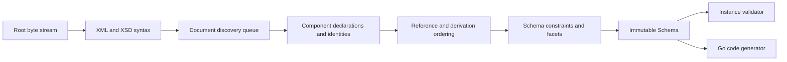

# Architecture

## Boundaries

Immutable models feed validation/generation.

## Deterministic phase pipeline



Identities intern before resolution; slices order walks/output.
Phases never backpatch.

## Input and resolution

`ParseSchema(root ResolvedSource, resolver Resolver)` uses Compatibility;
`ParseSchemaWithPolicy` selects policy. Resolvers acquire sources; streams close,
identities decode once.

```go
type Resolver interface {
    Resolve(ctx context.Context, namespaceURN, schemaLocation string) (ResolvedSource, error)
}
```

Sources retain opaque identity/context; resolvers own locations.
Discovery is sequential FIFO; resolver calls are sequential.
`Loc`: one-based lines, Unicode code-point columns.

## Diagnostics

Invalid/unsupported/resolution/internal diagnostics retain code, primary/related
`Loc`, spec reference, cause; errors prevent `Schema`. Unsupported
features have stable IDs.

## Schema model

Immutable components; ordered walks. Elements retain identity
constraints, XPath, namespace scopes, `Loc`s, and keyref targets.
IDs/duplicates precede refs; unresolved/invisible/ambiguous targets yield
`FailureResolution` at `refer`, wrong-kind/field-count `FailureInvalid`.

Bounded extensions over named empty bases and `xs:anyType` restrictions
retain refs, base IDs/`Loc`s, and `##other`/`lax` wildcards.
Grouped/sequence extension uses admit named/global-element inline owners; inline owners retain anonymous identity and exclude ID, inheritable, list/union uses.
SimpleContent retains base/type/use
`Loc`s, nil particle; restrictions reject. Bases: Boolean/string/integer/decimal or policy-gated `precisionDecimal`.
Direct/extension choices and sequences admit `integer`, built-in/named/inline
`negativeInteger`, built-in/named `long`/`int`/`short`/`byte`/`unsignedLong`/
`nonNegativeInteger`. Named direct choice/sequence/all admit effective
`positiveInteger`/`nonPositiveInteger` restrictions; `all` excludes anonymous
derivatives, extensions, and local attributes.
Built-in/named `integer` validate; anonymous `integer`/`negativeInteger`
require bounded list/union. Other derivatives/extensions query-only;
named effective-long retains identity/facets/order; SimpleContent excludes local derivatives.
Syntax/policy/occurrences precede mapping; refs precede omission.
Named direct choice/sequence and named-group sequence/nested-choice locals map matching `targetNamespace`.
Compatibility/Strict11 admit; Strict10 rejects; absent/mismatched owners or form/ref conflicts invalidate. [Contract](doc.go).
Groups nest opposites; refs resolve before `0/0`. Sequences/nested choices retain atomic
integer/string/token locals with copied IDs/facets/QNames/`Loc`s/bounds.
Type conflicts: XSD3063; ambiguity rejects with related `Loc`s.
Valid inline-simple/untyped `0/0` omits; nonzero/broader/deeper/
wildcard/`all` reject. Cycles XSD3062; consumers reject at group `RefLoc`.
Named direct `all`: ordered supported locals/refs, exact bounds/omission/duplicate
`Loc`s; XSD 1.0 maxima ≤1, XSD 1.1 repeats/outer `0/0`; anonymous simple-type
`0/0` omits; anonymous complex members/consumers reject.
AttributeUse retains order, IDs, `Loc`s; grouped: group→uses→base; sequence extension: children→uses→base.
`0/0`/prohibited uses omit; chameleon adopts; XSD 1.1 `targetNamespace` must match.
Named empty/choice/sequence/group/grouped/sequence-extension owners omit `inheritable=false/0` in Compatibility/Strict11;
Strict10, true/1, refs, and other owners reject.
Named empty, choice/sequence, grouped, and sequence extension owners query
facet-free `xs:ID` (Strict10: one), built-in/named `xs:NCName`, and
`xs:normalizedString` locals with copied effective facets. Inline/ref/value
forms and consumers reject.
Global attributes: built-in/named Boolean/integer/decimal/normalizedString/token/negativeInteger/positiveInteger/nonPositiveInteger/language/
NCName/anyURI/ID/long/int/short/byte/unsignedLong, policy-gated `precisionDecimal`.
Compatibility/Strict11 omit untyped-global `inheritable=false/0`;
Strict10/true/1 reject; refs reject at use `Loc`.
Inline varieties retain IDs/refs/`Loc`s/facets/`finalDefault`; atomic inline
`normalizedString` admits. Atomic NCName preserves enumeration order, inherited
narrowing, fixed collapse. Enumerated NCName list/union members reject;
facet-free admit. Explicit whiteSpace/pattern/length, local inline NCName,
list/union attribute refs, default/fixed, and consumers reject.
Default/fixed covers built-in/named Boolean/integer/decimal/token/negativeInteger/nonPositiveInteger/positiveInteger/long/int/short/byte/unsignedLong and policy-gated `precisionDecimal`.
Integer exact; unsignedLong digits-only Strict10, plus/signed-zero
Compatibility/Strict11. Local refs to global inline lists/unions reject; atomic
refs query-only. Inline defaults/fixed fail at value `Loc`;
invalid values retain causes/related `Loc`s. Conflicts locate fixed/default;
type-only unconstrained; global attribute consumers reject.

Complexes retain abstract/final/block provenance, groups/extensions/wildcards. Empty named bodies lack particle/occurrence; they and untyped globals admit empty `block` overriding defaults. Named block `Loc` persists; untyped view/block facts absent; nonempty policies/consumers reject.
`xs:any`: positive sets, 1.1 strict/lax/skip `notNamespace`, chameleons, `0/0`. Compatibility/Strict11 direct strict `notQName` retains source-ordered normalized tokens (duplicates), bindings/`Loc`, sorted unique expanded names; conflicts before omission; other placements/consumers reject.
`openContent=none` excludes Strict10; named groups retain refs/ranges.
Inline-complex `mixed=false/0`, inline-complex/untyped-global `abstract=false/0`/`nillable=false/0` omit; true/1 reject, malformed retain cause/`Loc`. Typed or inline-simple globals expose true.
Compatibility/Strict11 omit `defaultAttributesApply`; Strict10/schema `defaultAttributes` reject.
Inline IDs omit from walks; selected precisionDecimal sequences validate.
Bounded local lists use precisionDecimal; unions pair precisionDecimal/negativeInteger.
Strict10 rejects precisionDecimal. Element refs retain ranges.
Named direct choices/sequences query built-in/named `normalizedString`; consumers reject.
Facet-free `QName` varieties/global refs retain context; QName locals/attributes/facets/values reject.

## Datatypes

Lexical/value forms differ.
QName value conversion needs namespace context and remains unsupported.
Datatypes map string enumeration, arbitrary precision, exact Compatibility/Strict11
precisionDecimal facets, Boolean whitespace; broader facets/temporal values reject.

## Validation and code generation

`ValidateInstance` handles built-in/named Boolean/token/NMTOKEN/integer/
nonNegativeInteger/decimal/byte/short/int/long/unsignedLong and atomic `xs:string`
roots. Compatibility/Strict11 also handle precisionDecimal roots, named/inline
global lists, bounded unions, and ordered typed/ref sequences with anonymous
targets/inline roots; Strict10 rejects before publication. Lists split XML
whitespace; unions preserve member order. Selected variety attributes validate
on empty/sequence roots. Bounded variety sequences accept typed string/integer/
negativeInteger/precisionDecimal locals, anonymous integer/negativeInteger
locals, and refs. Outer occurrences default; child ranges exact. Local Boolean/integer/decimal
sequences/default choices honor ranges; token/NMTOKEN sequences retain large/
unbounded occurrences. Default direct-choice refs to unconstrained global
Boolean/integer/decimal validate; constrained targets relate `Loc`.
SimpleContent accepts built-in string with selected precisionDecimal attributes
or built-in/named effective precisionDecimal; named effective string excludes.
Inline roots validate selected sequences (including bounded list/union), attributes,
simpleContent; inline complex-content extensions reject even after 0/0/prohibited omission.
Mixed-content validation is unsupported; `GenerateGo` rejects inline complex roots.
Nonzero `xs:any` is query-only. Identity-constrained roots reject at instance-use `Loc`,
relating first constraint. QName globals/refs reject validation/generation with
located diagnostics. Structure precedes facets; first failure retains instance/
schema `Loc`s. Occurrence and scalar failures differ. `xsi:schemaLocation` never
resolves. Other byte/short/int/long/unsignedLong validation uses reject.

Generation admits named Boolean/integer/decimal/token/NMTOKEN/effective-atomic
`xs:string`, inline string/token/NMTOKEN, and global `nonNegativeInteger`/
`long`/`int`/`byte`. Default Boolean/integer/decimal choices/sequences and
all-token choices generate; other locals/attributes reject. `normalizedString`
and global `short`/`unsignedLong`/`negativeInteger`/`nonPositiveInteger`/
`positiveInteger`/`nonNegativeInteger`/`long`/`int`/`byte` refs reject.
No-view globals, admitted `abstract=true`/`nillable=true` globals, identity constraints yield `GOXSD9029`, nil output.
Default integer/decimal sequence refs retain TargetID/order. Built-in bounded
integers use `StrictInteger`; `IntegerBounds()` copies effective bounds.
Byte bounds [-128,127]; named facets retain provenance. Unsupported final/
variety/effective facets yield `GOXSD9029`; malformed facts `GOXSD9030`.
Nonzero inline `nonNegativeInteger` has no schema; valid `0/0` terms omit.

## Conformance

Pinned W3C artifacts classify pass/conformance/unsupported/resolution/internal
outcomes; tooling checks XSD 1.0 envelope/DTD order without changing parser behavior.
