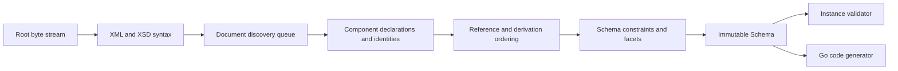

# Architecture

## Pipeline



Identities intern before resolution; slices order walks/output; no backpatching.

## Resolution

`ParseSchema` uses Compatibility;
`ParseSchemaWithPolicy` selects policy. Resolvers acquire sources; streams close,
identities decode once.

```go
type Resolver interface {
    Resolve(ctx context.Context, namespaceURN, schemaLocation string) (ResolvedSource, error)
}
```

Sources retain opaque identity/context; resolvers own locations.
FIFO discovery; sequential calls.
`Loc`: one-based lines, Unicode code-point columns.

## Diagnostics

Diagnostics retain class/code, primary/related `Loc`, spec reference, cause;
errors prevent `Schema`.

## Schema model

Elements retain identity constraints, XPath, namespace scopes, `Loc`s, keyref targets.
IDs/duplicates precede refs; unresolved/invisible/ambiguous targets yield
`FailureResolution` at `refer`, wrong-kind/field-count `FailureInvalid`.

Empty-base extensions and named/global-inline restrictions retain IDs/`Loc`s/wildcards.
Built-in xs:anyType ##other/lax restrictions supported. Named-base
restrictions require completed empty/attribute-only/direct/extension/restriction
bases with nil particle/zero uses; grouped/simple-content unsupported.
Named-base derived `namespace`/`processContents` explicit: namespace subset
of base ##any/##other/positive-set, process always equal/stronger.
##other preserves origin: XSD10 equality;
XSD11/Compatibility exclusion containment.
`notNamespace`/`notQName` unsupported. Missing base wildcard invalid at derived
wildcard; missing derived wildcard unsupported. Broader/weaker wildcards, final,
cycles invalid; richer derived particles/uses/group refs or nonempty/used bases
unsupported. Consumers reject.
Anonymous grouped/sequence IDs persist; ID/list/union, grouped/nested `inheritable` excluded.
SimpleContent retains base/type/use `Loc`s, nil particle; base/final/dependencies precede owner/use gates. Boolean/string/integer/decimal, policy-gated `precisionDecimal`.
Attribute-free simpleContent extensions query selected atomic bases; restrictions reject.
Direct/extension particles model selected integer-family locals; named direct
adds sign restrictions. Built-in/named integers validate; other derivatives/
extensions remain query-only.
Syntax/policy/occurrences precede mapping; refs precede omission.
Named direct choice/sequence and named-group sequence/nested-choice locals match `targetNamespace`.
Compatibility/Strict11 admit; Strict10, absent/mismatched owners, form/ref conflicts invalidate.
Groups nest opposites; refs precede `0/0`. Sequences/nested choices retain atomic integer/string/token locals with copied IDs/facets/QNames/`Loc`s/bounds.
Anonymous empty-base extensions admit ref-only choice, nested group-ref/element-ref sequence, or both; bounds/order/targets/`Loc`s/wildcard persist.
Broader nesting/direct groups/wildcards/locals/nested attributes reject.
Type conflicts: XSD3063; ambiguity relates `Loc`s.
Valid inline-simple/untyped `0/0` omits; nonzero/broader/deeper/
wildcard/`all` reject. Cycles XSD3062; consumers reject at group `RefLoc`.
Named direct `all`: ordered supported locals/refs, exact bounds/omission/duplicate
`Loc`s; XSD 1.0 maxima ≤1, XSD 1.1 repeats/outer `0/0`; anonymous simple-type
`0/0` omits; anonymous complex members/consumers reject.
Ordered uses; models→uses→base resolution.
`0/0`/prohibited omit; chameleons adopt; 1.1 `targetNamespace` matches.
Compatibility/Strict11 omit false/0 `inheritable` for supported named empty/all/choice/sequence/group/grouped/sequence-extension locals (ID included) and anonymous global-element inline complexContent direct-sequence name-bearing non-ID locals; Strict10/true/1/refs/other-owners reject.
Named empty/choice/sequence/grouped-extension/sequence-extension: facet-free `xs:ID`, built-in/named
`xs:NCName`/`xs:normalizedString`; named all: facet-free `xs:ID`. Strict10: one effective ID/owner.
Named empty/choice/sequence/all: built-in `xs:language`/`xs:anyURI`;
named empty: built-in/named `xs:token`/`xs:NMTOKEN`.
Anonymous empty-base ref-sequences: built-in `xs:token`/`xs:anyURI`; consumers reject.
Named empty/choice/sequence and named direct-sequence extensions over supported use-free empty bases (wildcard inherited): built-in/named `xs:long`.
Named empty: built-in/named `xs:short`/`xs:int`/`xs:byte`/`xs:unsignedLong`; facets copied.
Named datatypes exclude inline/ref/value/other owners; anonymous token/anyURI ref-sequences excepted; consumers reject.
Global attributes: built-in/named Boolean/integer/decimal/normalizedString/token/negativeInteger/positiveInteger/nonPositiveInteger/language/
NCName/anyURI/ID/long/int/short/byte/unsignedLong, policy-gated `precisionDecimal`.
Compatibility/Strict11 omit untyped-global `inheritable=false/0`;
Strict10/true/1 reject; refs reject at use `Loc`.
Inline varieties retain IDs/refs/`Loc`s/facets/`finalDefault`; atomic inline
`normalizedString` admits. Atomic NCName preserves enumeration order, inherited
narrowing, fixed collapse. Enumerated NCName list/union members reject;
facet-free admit. Explicit whiteSpace/pattern/length, local inline NCName,
list/union attribute refs, default/fixed, and consumers reject.
Default/fixed covers built-in/named Boolean/integer/decimal/token/negativeInteger/nonPositiveInteger/positiveInteger/long/int/short/byte/unsignedLong and policy-gated `precisionDecimal`.
Integer exact; unsignedLong digits-only Strict10, plus/signed-zero
Compatibility/Strict11. Local refs to global inline lists/unions reject; atomic
refs query-only. Inline defaults/fixed fail at value `Loc`;
invalid values retain causes/related `Loc`s. Conflicts locate fixed/default;
type-only unconstrained; global attribute consumers reject.

Complexes retain abstract/final/block provenance, groups/extensions/wildcards.
Empty named bodies lack particles/occurrences; they and untyped globals admit
empty `block` overrides. Named block `Loc` persists; untyped view/block
facts absent; nonempty block policies/consumers reject.
`xs:any`: positive sets, 1.1 strict/lax/skip `notNamespace`, chameleons, `0/0`. Compatibility/Strict11 direct strict `notQName` retains source-ordered normalized tokens (duplicates), bindings/`Loc`, sorted unique expanded names; conflicts before omission; other placements/consumers reject.
`openContent=none` excludes Strict10; named groups retain refs/ranges.
Inline-complex `mixed=false/0`, inline-complex/untyped-global `abstract=false/0`/`nillable=false/0` omit; true/1 reject, malformed retain cause/`Loc`. Typed or inline-simple globals expose true.
Compatibility/Strict11 omit `defaultAttributesApply`; Strict10/schema `defaultAttributes` reject.
Inline IDs omit from walks; selected precisionDecimal sequences validate.
Validated local lists use precisionDecimal; unions pair precisionDecimal/negativeInteger.
Named grouped extensions query optional local `final` through structurally
matched named `xs:simpleDerivationSet`; its union/list values and consumers reject.
Strict10 rejects precisionDecimal. Element refs retain ranges.
Named direct choices/sequences query built-in/named `normalizedString`; consumers reject.
Facet-free `QName` varieties/global refs retain context; QName locals/attributes/facets/values reject.

## Datatypes

Lexical/value forms differ.
QName value conversion needs namespace context; unsupported.
Datatypes map string enumeration, arbitrary precision, exact Compatibility/Strict11
precisionDecimal facets, Boolean whitespace; broader facets/temporal values reject.

## Validation and code generation

Validation handles selected scalar roots, lists/unions, ordered
typed/ref sequences. Compatibility/Strict11 admit precisionDecimal; Strict10
rejects it before publication. Lists split XML whitespace; unions preserve
member order. Bounded variety sequences accept selected typed/anonymous locals
and refs. Outer occurrences default; child ranges are exact. Default direct-choice
refs to unconstrained Boolean/integer/decimal globals validate; constrained
targets relate `Loc`.
SimpleContent accepts built-in string with selected precisionDecimal attributes
or built-in/named effective precisionDecimal; named effective string excludes.
Inline roots validate selected sequences (bounded list/union), attributes,
simpleContent; inline complex-content extensions reject after 0/0/prohibited omission.
Mixed-content validation and inline-complex generation remain unsupported.
Nonzero `xs:any` query-only. Identity-constrained roots reject at instance-use `Loc`,
relating first constraint. QName globals/refs reject validation/generation.
Structure precedes facets; first failure retains instance/
schema `Loc`s. Occurrence and scalar failures differ. `xsi:schemaLocation` never
resolves; other byte/short/int/long/unsignedLong validation uses reject.

Generation covers selected named/inline scalars, default Boolean/integer/decimal
choices/sequences, all-token choices. Other locals/attributes/reference targets
reject.
No-view, `abstract=true`/`nillable=true`, identity-constrained globals yield `GOXSD9029`, nil output.
Default integer/decimal sequence refs retain TargetID/order. Built-in bounded
integers use `StrictInteger`; `IntegerBounds()` copies effective bounds.
Byte bounds [-128,127]; unsignedLong bounds [0,18446744073709551615]. Named
facets retain provenance. Unsupported final/
variety/effective facets yield `GOXSD9029`; malformed facts `GOXSD9030`.
Nonzero inline `nonNegativeInteger` has no schema; valid `0/0` terms omit.

## Conformance

Pinned W3C artifacts classify pass/conformance/unsupported/resolution/internal
outcomes; tooling checks XSD 1.0 envelope/DTD order outside parsing.
